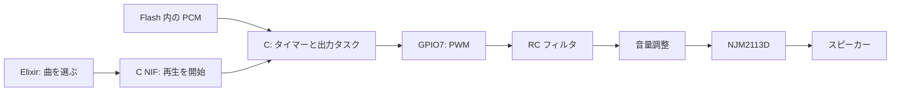
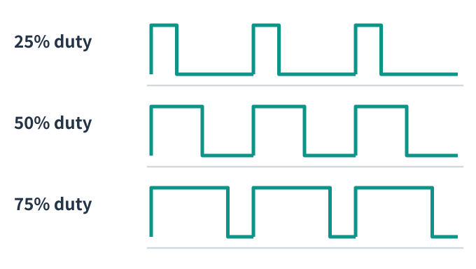
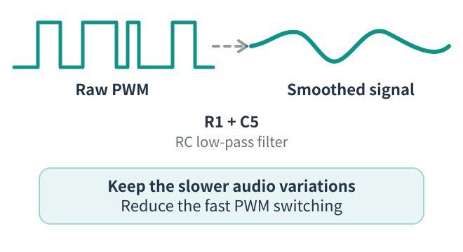
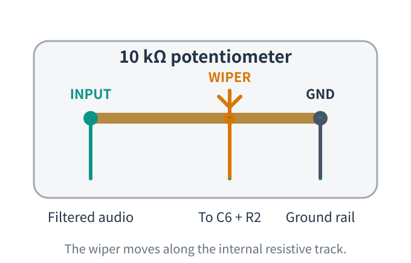
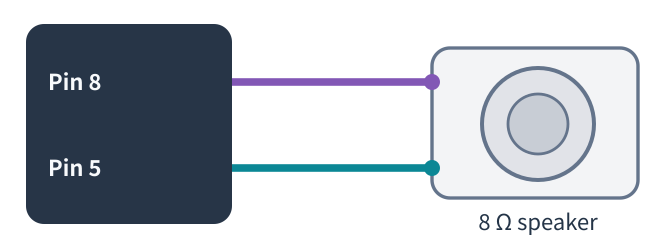

# 音声再生の仕組み

「パパパ」の再生は、**数値を読む → パルスの幅を変える → 回路で音声信号にする**という流れです。ここでは実際の部品とコードに沿って追います。



## 1. PCM は音の数値データ

PCM（Pulse Code Modulation）は、一定間隔の音の振幅を数値で表す方式です。この実験では、Python で合成した練習音源を次の形式にします。

| 項目 | この実験での値 | 意味 |
| --- | --- | --- |
| サンプルレート | 8 kHz | 1 秒間に 8,000 個の値を読む |
| 分解能 | unsigned 8-bit | 1 個の値が 0〜255、中央は 128 |
| チャンネル | mono | 音声は 1 系統 |

たとえば `[128, 140, 150, 140, 128, 116, 106, ...]` が波の一部です。128 が続けば音声の変化がなく、中央から上下する値が音になります。**1 秒分は 8,000 bytes**、10 秒なら約 80 kB です。

`scripts/build_assets.py` は、音の高さを決める基本波と倍音に、立ち上がり・減衰・短い息のような成分を加えて練習音源を合成します。メロディーだけでなく、倍音や発音の形も声らしさに関わります。

## 2. PWM は GPIO から値を出す方法

GPIO 自体は HIGH / LOW の出力ですが、高速に切り替えて **HIGH の時間の割合（デューティ比）**を変えると、フィルタ後の平均電圧を変えられます。LEDC は ESP32 の PWM 用周辺回路です。



波の高さではなく、HIGH でいる時間の長さが変わる点に注目してください。

8-bit PWM では、PCM 値をそのまま duty に使います。

| PCM 値 | HIGH の割合 | 3.3 V 出力の理想的な平均電圧 |
| ---: | ---: | ---: |
| 64 | 25% | 約 0.825 V |
| 128 | 50% | 約 1.65 V |
| 192 | 75% | 約 2.475 V |

これは無負荷で考えた目安です。実際の電圧はフィルタや音量回路の負荷にも依存します。

**サンプルレートと PWM 周波数は別のものです。**

- **8 kHz**：PCM の次の値へ進む速さ。125 µs ごとに duty を更新する。
- **約 156 kHz**：その duty で GPIO を繰り返し HIGH / LOW にする速さ。

LEDC へは 156,250 Hz を要求し、実機ではドライバが 156,352 Hz と報告しました。オシロスコープで測った値ではありません。

## 3. 回路がパルスを音声信号に変える

[配線図](assets/wiring.svg) を左から右へ追ってください。

| 部分 | 何をする？ |
| --- | --- |
| R1 10 kΩ + C5 1 nF | **RC ローパスフィルタ**。高速な PWM 成分を弱め、ゆっくりした音声の変化を取り出す |
| RV1 10 kΩ | **音量調整**。信号を分圧し、ワイパーからアンプへ渡す大きさを変える |
| C6 0.1 µF | **AC カップリング**。PWM の平均電圧による直流成分を遮り、音声の変化を通す |
| R2 10 kΩ + R3 47 kΩ | **入力と負帰還**。出力の一部を入力へ戻し、アンプの増幅率を決める |
| C7 1 µF + C8 4.7 µF | アンプの入力・内部基準電圧を安定させる |
| C9 10 µF + 追加の 0.1 µF | **電源デカップリング**。電源の変動を抑える。追加の 0.1 µF は IC の電源ピンの近くへ置く |
| NJM2113D + スピーカー | 小さな信号をもとに、電源のエネルギーでスピーカーを動かす |

### フィルタ：高速な変化を弱める



デューティ比の変化を平滑化する概念図です。実測波形や実際の時間スケールを表すものではありません。

RC フィルタを単独で考えると、折れ点は `1 / (2πRC)`、この値では約 15.9 kHz です。これは高い周波数が急に消える境界ではありません。後段の可変抵抗なども特性に影響するため、単独の式だけで完成回路の音質は決まりません。

### 音量調整：抵抗の途中から信号を取り出す



ワイパー（WIPER）は、つまみで動かせる接点です。GND 側へ寄せると小さな信号、入力（INPUT）側へ寄せると大きな信号を取り出せます。端子の実際の並びは部品の端子図で確認します。

### スピーカー：両端をアンプで駆動する

NJM2113D は **BTL（Bridge-Tied Load）**方式です。スピーカーの両端を pin 5 / 8 の出力で駆動し、その電圧差で音を出します。スピーカーの片側を GND に落とす接続にはしません。[メーカー資料](https://www.nisshinbo-microdevices.co.jp/en/products/audio-amplifier/spec/?product=njm2113) も参照してください。



## 4. Elixir は曲を選び、C は一定間隔で出力する

NIF（Native Implemented Function）は、Elixir から C の処理を呼ぶ入口です。Elixir は開始・状態確認・繰り返しを担当し、1 サンプルごとの出力は C に任せます。

C 側では GPTimer が 8 MHz で数え、1000 カウントごとに割り込みます。割り込み処理は FreeRTOS の出力タスクへ通知し、タスクが最新の PCM 値を LEDC へ渡します。

```text
GPTimer の割り込み → タスクへ通知 → PCM を読む
    → ledc_set_duty() → ledc_update_duty()
```

タスクの処理が遅れたときは、最新のサンプル位置へ進み、飛ばした数を `skipped_samples` に加えます。これは曲を引き延ばさないための処理ですが、欠落があれば音切れにつながります。0 でも、配線や音質が正しいとは限りません。

今回の ESP-IDF 5.5 では `ledc_set_duty_and_update()` に fade service が必要でした。このプレーヤーは出力タスクが duty 更新を専有するため、上の 2 つの API を使っています。[動作確認のまとめ](hardware-validation.md) に再現時の要点をまとめています。

## 5. コードを読む順番

| ファイル | 注目するところ |
| --- | --- |
| [lib/hello_atomvm_papapa.ex](../lib/hello_atomvm_papapa.ex) | 起動 → 曲の再生 → 完了待ち。RESET でこの流れが再開する |
| [player.ex](../lib/hello_atomvm_papapa/player.ex) / [native.ex](../lib/hello_atomvm_papapa/native.ex) | 曲名から ID を求め、NIF を呼ぶ境界 |
| [audio_nif.c](../components/papapa_audio/audio_nif.c) | `sample_tick`、`audio_worker`、`pwm_write` のつながり |
| [build_assets.py](../scripts/build_assets.py) | 合成した波形を PCM 配列にする処理 |

音源の本体は Flash 内の生成 C 配列です。**曲の選択だけなら Elixir アプリを書き換え、PCM データを変えるならファームウェアも書き換えます。** C 配列・ヘッダ・Elixir カタログは、生成スクリプトで一緒に更新します。

まずは [PC プレビューと曲の切り替え](getting-started.md#4-曲を変える) で、低音・高音の違いを聴いてみてください。音源の振幅、音量つまみ、アンプの増幅はそれぞれ別の段階で音の大きさに関わります。
