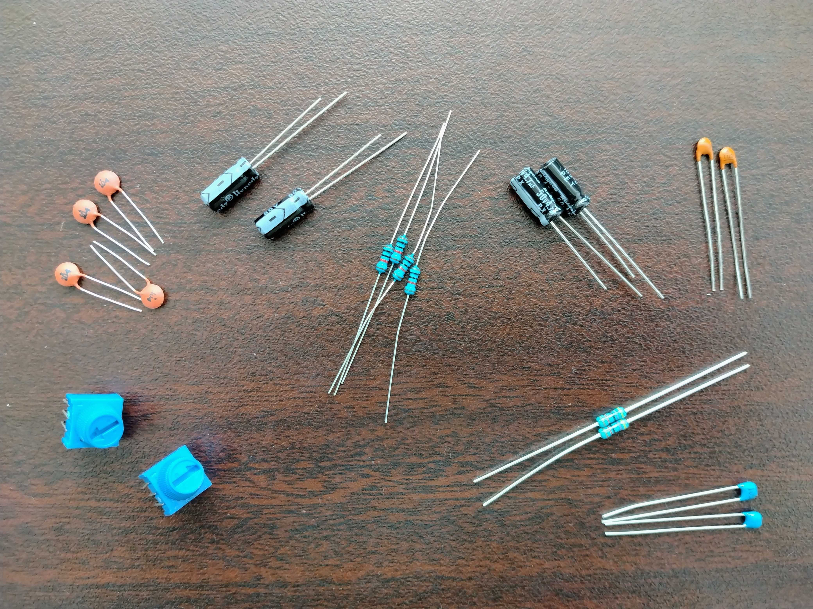
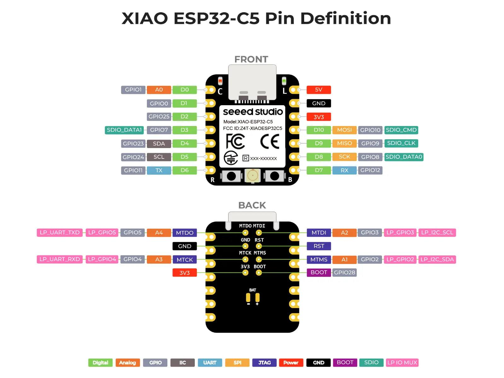
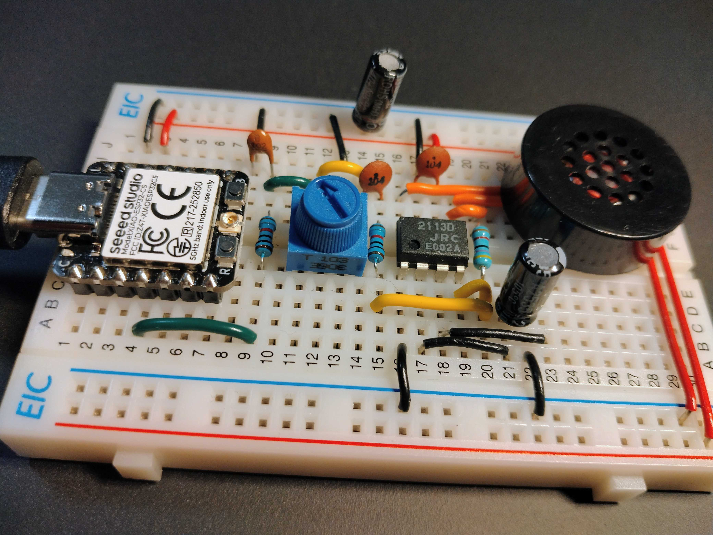
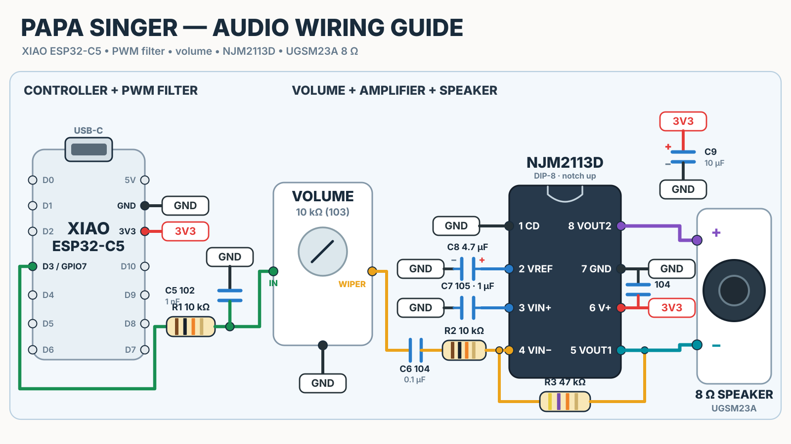

# 配線と部品

XIAO が音声信号を作り、NJM2113D がスピーカーを駆動します。まず電源、次に音声の通り道をつなぎます。

## 部品をそろえる

| 部品 | 値・型番 | 数 | 役割 |
| --- | --- | ---: | --- |
| マイコン | Seeed Studio XIAO ESP32-C5 | 1 | PWM 音声出力 |
| アンプ | NJM2113D（DIP-8） | 1 | スピーカーを駆動 |
| スピーカー | UGSM23A、8 Ω / 0.08 W | 1 | 音を出す |
| R1・R2 | 10 kΩ | 2 | フィルタ・アンプ入力 |
| R3 | 47 kΩ | 1 | アンプの帰還 |
| RV1 | 10 kΩ 可変抵抗 | 1 | 音量調整 |
| C5 | 1 nF（`102`） | 1 | PWM フィルタ |
| C6・追加バイパス | 0.1 µF（`104`） | 2 | 音声の結合・電源の安定化 |
| C7 | 1 µF（`105`） | 1 | アンプ入力の基準 |
| C8 | 4.7 µF | 1 | アンプの基準電圧 |
| C9 | 10 µF | 1 | 電源の安定化 |

ほかにブレッドボード、ジャンパーワイヤー、USB データケーブルが必要です。抵抗・コンデンサの番号は下の配線図に対応します。



部品の外観の参考です。写真内の部品数が、上の必要数と同じとは限りません。セラミックコンデンサの `102`・`104`・`105` はそれぞれ 1 nF・0.1 µF・1 µF を表します。

## 1. XIAO の 3 本を確認する



[Seeed Studio のピン配置](https://wiki.seeedstudio.com/xiao_esp32c5_getting_started/#pin-map) を参照。**表面を上、USB コネクタを上**にした向きで、右側の上から `5V`、`GND`、`3V3`、左側の上から 4 本目が `D3` です。

| XIAO の表示 | 接続先 |
| --- | --- |
| **3V3** | アンプの電源。NJM2113D pin 6 へ |
| **GND** | 回路全体の共通 GND。NJM2113D pin 7 へ |
| **D3 / GPIO7** | R1 を通して音声回路へ |

`D3` は基板上の名前、`GPIO7` はプログラムで使う番号です。**今回、5V ピンは使いません。** 実機写真は USB が左を向いているため、図と向きを合わせてからピンを追ってください。



## 2. 回路をつなぐ

**USB を外してから配線します。** 図の `3V3` はすべて同じ電源、`GND` はすべて共通です。ブレッドボードの電源レールが途中で分かれている場合は、必要な区間をジャンパーで接続します。



### 先にアンプの電源とピン番号を確認

NJM2113D を上から見た配置です。丸印・切り欠き側の pin 1 を基準に、反時計回りに数えます。

```text
        切り欠き
      ┌──────────┐
   CD │ 1      8 │ VOUT2
 VREF │ 2      7 │ GND
 +VIN │ 3      6 │ 3V3
 −VIN │ 4      5 │ VOUT1
      └──────────┘
```

| 接続 | 内容 |
| --- | --- |
| 電源 | pin 6 → 3V3、pin 7 → GND |
| 動作有効 | pin 1（CD）→ GND |
| 電源コンデンサ | 3V3/GND 間に C9 10 µF と追加の 0.1 µF。追加分は pin 6 / 7 の近く |
| 基準電圧 | pin 2 → C8 4.7 µF → GND、pin 3 → C7 1 µF → GND |

C8 が電解なら **+ を pin 2 側**、C9 が電解なら **+ を 3V3 側**に向けます。C5・C6・C7・追加の 0.1 µF にセラミックを使う場合、極性はありません。

### 次に音声の通り道を確認

| 部分 | 接続 |
| --- | --- |
| フィルタ | D3/GPIO7 → R1 10 kΩ → フィルタ点。フィルタ点 → C5 1 nF → GND |
| 音量 | フィルタ点 → RV1 の外側端子。もう一方の外側端子 → GND |
| 入力 | RV1 の中央端子（ワイパー）→ C6 0.1 µF → R2 10 kΩ → pin 4 |
| 帰還 | pin 4 と pin 5 の間に R3 47 kΩ |
| スピーカー | + → pin 8、− → pin 5。**どちらも GND につながない** |

可変抵抗の端子は部品の形状により並びが異なります。端子図でワイパーを確認してください。GND 側へワイパーを寄せた位置が最小音量です。

## 3. 通電前に確認する

1. XIAO の **3V3 → pin 6、GND → pin 7** を実際のピンから追う。
2. IC の向き、電解コンデンサの極性、スピーカー両端が pin 5 / 8 へ接続されていることを確認する。
3. 3V3 と GND の短絡がないことを確認し、音量を最小にする。

実機試験で残った無音は、XIAO の 3V3/GND の誤配線を直すと解消しました。USB で XIAO が起動しても、アンプへ電源が届いているとは限りません。

写真は配置の参考にし、接続先は配線図と表で確認します。回路の各部が何をするかは [音声再生の仕組み](audio-design.md#3-回路がパルスを音声信号に変える) を参照してください。

準備できたら [最初の音を出す](getting-started.md) へ進みます。

参考：[Piyopiyo PCB v1.9 回路図（PDF）](https://github.com/piyopiyoex/piyopiyo-pcb/blob/main/hardware/v1.9/docs/piyopiyo-pcb.pdf) / [NJM2113 メーカー資料](https://www.nisshinbo-microdevices.co.jp/en/products/audio-amplifier/spec/?product=njm2113)
